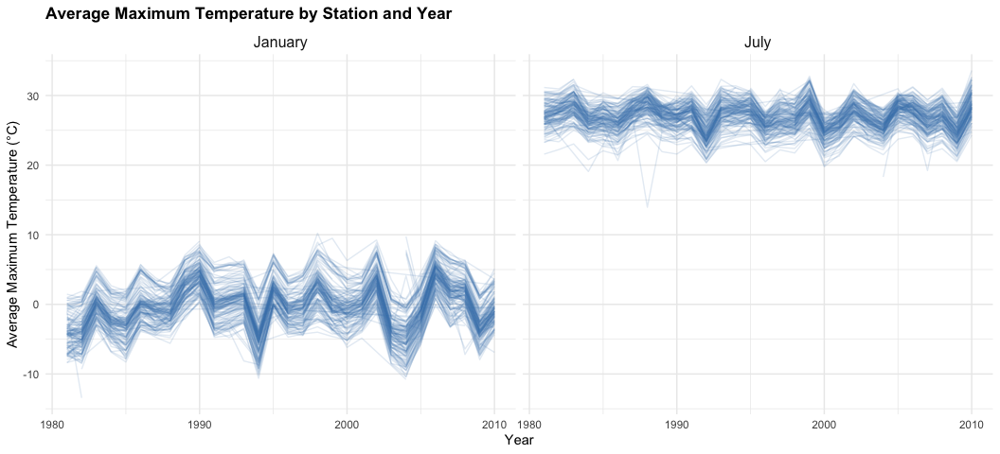
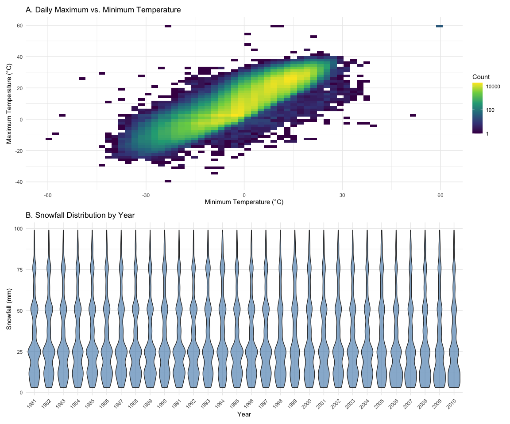
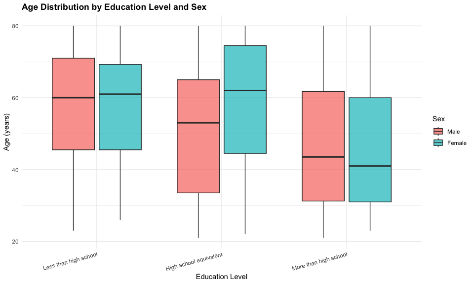
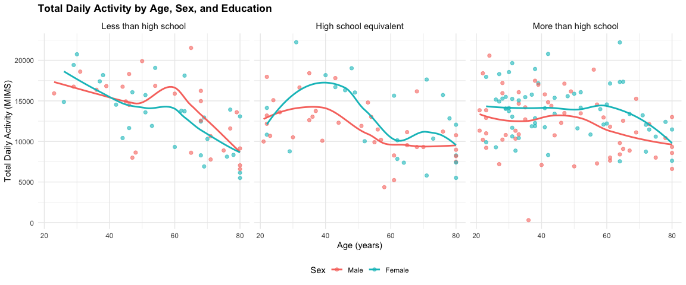
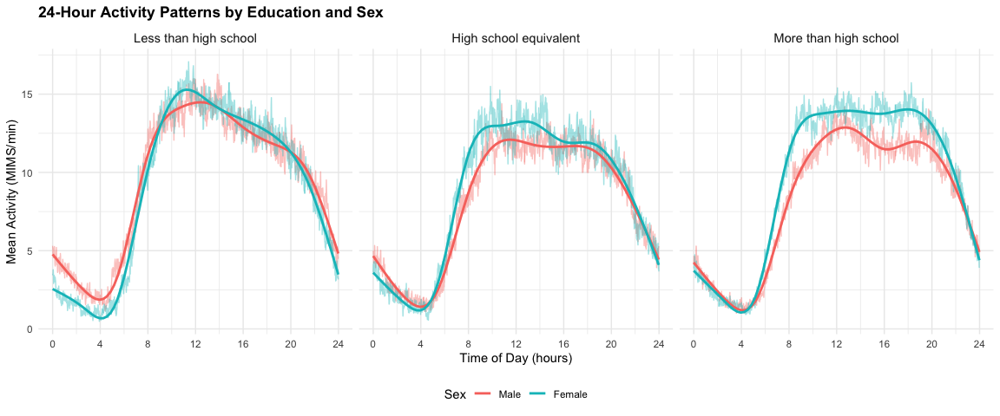

p8105_hw3_xq2270
================
Xiaohan Qiang
2026-10-19

# Problem 1

``` r
data("ny_noaa")
```

``` r
noaa_clean =
  ny_noaa |>
  mutate(
    year = lubridate::year(date),
    month = lubridate::month(date),
    day = lubridate::day(date),
    tmax = as.numeric(tmax) / 10,
    tmin = as.numeric(tmin) / 10,
    prcp = prcp / 10
  )
```

The `ny_noaa` dataset contains 2,595,176 observations and 7 variables,
representing daily weather measurements from NOAA stations in New York
State. Key variables include station ID, observation date,
precipitation, snowfall, snow depth, and daily maximum and minimum
temperatures.

Missing data are substantial, particularly for temperature measurements:
43.7% of both `tmax` and `tmin` observations are missing. Missingness is
also present in precipitation (5.62%), snowfall (14.7%), and snow depth
(22.8%). Station IDs and dates have no missing values.

For data cleaning, I extracted year, month, and day from the date
variable, converted temperatures to degrees Celsius and precipitation to
millimeters, and retained snowfall and snow depth in millimeters.

``` r
snow_frequency =
  noaa_clean |>
  count(snow, sort = TRUE)

head(snow_frequency, 10)
```

The most commonly observed snowfall value is 0 mm (2,008,508
observations), reflecting the fact that snowfall does not occur on most
days. Among nonzero values, 25 mm and 13 mm are particularly common,
followed by 51 mm and 76 mm. These values approximately correspond to
common measurements in inches (1, 0.5, 2, and 3 inches), suggesting that
rounding and conversion from inches to millimeters contribute to the
observed frequencies. Missing snowfall values are excluded from this
interpretation.

``` r
monthly_tmax =
  noaa_clean |>
  filter(month %in% c(1, 7), !is.na(tmax)) |>
  group_by(id, year, month) |>
  summarise(
    mean_tmax = mean(tmax),
    .groups = "drop"
  ) |>
  mutate(
    month = factor(
      month,
      levels = c(1, 7),
      labels = c("January", "July")
    )
  )

monthly_tmax |>
  ggplot(aes(x = year, y = mean_tmax, group = id)) +
  geom_line(alpha = 0.15, color = "steelblue") +
  facet_wrap(~ month, ncol = 2) +
  labs(
    title = "Average Maximum Temperature by Station and Year",
    x = "Year",
    y = "Average Maximum Temperature (°C)"
  ) +
  theme(
    plot.title = element_text(size = 13, face = "bold"),
    axis.title = element_text(size = 11),
    strip.text = element_text(size = 12)
  )
```

<!-- -->
The two-panel plot shows a clear seasonal difference in average maximum
temperature. January temperatures generally cluster around 0°C, whereas
July temperatures are mostly between 25°C and 30°C. Temperatures across
stations tend to fluctuate together over time, suggesting shared
year-to-year weather patterns. There are also a few potential outliers,
including an unusually low July average around 1988. These observations
may reflect unusual weather conditions or limited station-level data and
would require further investigation.

``` r
temperature_plot =
  noaa_clean |>
  filter(!is.na(tmax), !is.na(tmin)) |>
  ggplot(aes(x = tmin, y = tmax)) +
  geom_bin_2d(bins = 60) +
  scale_fill_viridis_c(trans = "log10") +
  labs(
    title = "A. Daily Maximum vs. Minimum Temperature",
    x = "Minimum Temperature (°C)",
    y = "Maximum Temperature (°C)",
    fill = "Count"
  )

snowfall_plot =
  noaa_clean |>
  filter(!is.na(snow), snow > 0, snow < 100) |>
  ggplot(aes(x = factor(year), y = snow)) +
  geom_violin(fill = "steelblue", alpha = 0.6) +
  labs(
    title = "B. Snowfall Distribution by Year",
    x = "Year",
    y = "Snowfall (mm)"
  ) +
  theme(
    axis.text.x = element_text(angle = 45, hjust = 1)
  )

patchwork::wrap_plots(
  temperature_plot,
  snowfall_plot,
  ncol = 1
)
```

<!-- -->
The temperature plot shows a strong positive relationship between daily
minimum and maximum temperatures, with most observations concentrated
along an upward-sloping band. A few extreme or inconsistent values are
visible and may reflect measurement or recording errors.

The snowfall distributions are broadly similar across years, with
prominent peaks around 13, 25, 51, and 76 mm. These peaks are consistent
with common snowfall measurements originally recorded in inches and
converted to millimeters. There is no clear systematic change in the
shape of the annual distributions. However, these plots describe the
distribution of individual nonzero snowfall observations rather than
annual snowfall totals.

# Problem 2

## Data Import and Cleaning

``` r
nhanes_covar =
  read_csv("data/nhanes_covar.csv", skip = 4)

nhanes_accel =
  read_csv("data/nhanes_accel.csv")
```

``` r
nhanes_covar_clean =
  nhanes_covar |>
  janitor::clean_names() |>
  filter(age >= 21) |>
  drop_na() |>
  mutate(
    sex = factor(
      sex,
      levels = c(1, 2),
      labels = c("Male", "Female")
    ),
    education = factor(
      education,
      levels = c(1, 2, 3),
      labels = c(
        "Less than high school",
        "High school equivalent",
        "More than high school"
      )
    )
  )

nhanes_accel_long =
  nhanes_accel |>
  janitor::clean_names() |>
  pivot_longer(
    cols = starts_with("min"),
    names_to = "minute",
    names_prefix = "min",
    values_to = "mims"
  ) |>
  mutate(
    minute = as.integer(minute)
  )

nhanes_complete =
  nhanes_covar_clean |>
  inner_join(nhanes_accel_long, by = "seqn")
```

The demographic and accelerometer datasets each initially contained 250
participants. After excluding individuals younger than 21 and those with
missing demographic information, 228 participants remained, including
118 men and 110 women. The accelerometer data were reshaped into long
format and merged with demographic information using participant ID
(`seqn`). The resulting dataset contains 328,320 observations,
corresponding to 1,440 minute-level activity measurements for each of
the 228 participants.

## Demographic Summary

``` r
education_sex_table =
  nhanes_covar_clean |>
  count(education, sex) |>
  pivot_wider(
    names_from = sex,
    values_from = n,
    values_fill = 0
  )

education_sex_table |>
  knitr::kable(
    col.names = c("Education Level", "Men", "Women"),
    caption = "Number of Participants by Education Level and Sex"
  )
```

| Education Level        | Men | Women |
|:-----------------------|----:|------:|
| Less than high school  |  27 |    28 |
| High school equivalent |  35 |    23 |
| More than high school  |  56 |    59 |

Number of Participants by Education Level and Sex

``` r
nhanes_covar_clean |>
  ggplot(aes(x = education, y = age, fill = sex)) +
  geom_boxplot(alpha = 0.7, outlier.alpha = 0.5) +
  labs(
    title = "Age Distribution by Education Level and Sex",
    x = "Education Level",
    y = "Age (years)",
    fill = "Sex"
  ) +
  theme(
    plot.title = element_text(face = "bold"),
    axis.text.x = element_text(angle = 15, hjust = 1)
  )
```

<!-- -->
Among the 228 eligible participants, 118 were men and 110 were women.
The largest education group was more than high school (115
participants), followed by high school equivalent (58) and less than
high school (55). Sex distributions were relatively balanced in the
lowest and highest education categories, while men outnumbered women in
the high school equivalent group.

The age distributions suggest that participants with more than a high
school education tend to be younger, with median ages in the early 40s,
compared with approximately 60 years among those with less than a high
school education. Within the high school equivalent group, women have a
higher median age than men. However, age distributions overlap
considerably across groups.

## Total Daily Activity

``` r
nhanes_daily =
  nhanes_complete |>
  group_by(seqn, sex, age, bmi, education) |>
  summarise(
    total_activity = sum(mims, na.rm = TRUE),
    .groups = "drop"
  )
```

``` r
nhanes_daily |>
  ggplot(aes(x = age, y = total_activity, color = sex)) +
  geom_point(alpha = 0.6, size = 1.8) +
  geom_smooth(
    method = "loess",
    se = FALSE,
    linewidth = 1
  ) +
  facet_wrap(~ education, nrow = 1) +
  labs(
    title = "Total Daily Activity by Age, Sex, and Education",
    x = "Age (years)",
    y = "Total Daily Activity (MIMS)",
    color = "Sex"
  ) +
  theme(
    plot.title = element_text(face = "bold"),
    strip.text = element_text(size = 11),
    legend.position = "bottom"
  )
```

<!-- -->
Total daily activity generally decreases with age across education
levels, with particularly noticeable declines among older participants.
In the high school equivalent group, women show relatively high activity
levels around ages 30–40, followed by a decline. In the more than high
school group, women tend to have slightly higher smoothed activity
levels than men across much of the age range. However, individual
variability is substantial, and the smoothed curves should be
interpreted cautiously, particularly where observations are sparse. One
unusually low activity value is visible among younger men in the highest
education category.

## 24-Hour Activity Patterns

``` r
nhanes_timecourse =
  nhanes_complete |>
  group_by(education, sex, minute) |>
  summarise(
    mean_mims = mean(mims, na.rm = TRUE),
    .groups = "drop"
  ) |>
  mutate(
    hour = (minute - 1) / 60
  )
```

``` r
nhanes_timecourse |>
  ggplot(aes(x = hour, y = mean_mims, color = sex)) +
  geom_line(alpha = 0.4, linewidth = 0.5) +
  geom_smooth(
    se = FALSE,
    span = 0.08,
    linewidth = 1
  ) +
  facet_wrap(~ education, nrow = 1) +
  scale_x_continuous(
    breaks = seq(0, 24, by = 4)
  ) +
  labs(
    title = "24-Hour Activity Patterns by Education and Sex",
    x = "Time of Day (hours)",
    y = "Mean Activity (MIMS/min)",
    color = "Sex"
  ) +
  theme(
    plot.title = element_text(face = "bold"),
    strip.text = element_text(size = 11),
    legend.position = "bottom"
  )
```

<!-- -->
The 24-hour activity curves show a clear daily pattern across all
education levels. Mean activity is lowest during the early morning hours
(approximately 3–5 AM), increases rapidly after 6 AM, remains relatively
high throughout the daytime, and declines during the evening.

Participants with more than a high school education generally show
higher daytime activity than those in the high school equivalent group.
Sex differences also vary by education level: women tend to have higher
daytime activity than men in the highest education category, whereas the
male and female curves are more similar among participants with less
than a high school education.

These patterns suggest differences in daily activity timing and
intensity across demographic groups, although the observed associations
do not establish causal relationships.
